# Chess Match Outcome Prediction

Machine learning models that estimate the outcome of online chess games (Lichess) using only information available **before the game**: ratings, time control, opening and rated/casual status. The project covers the full path from data cleaning to a tested inference module and a monitoring plan.

## TL;DR

- **Two product questions, two models.** A 3-class model (white / draw / black) produces the probabilities shown to players; a binary model flags matches where the **favorite does not win**, for the matchmaking team.
- **Rating difference is the main signal, but it is not deterministic:** the higher-rated player wins only **65.59%** of decisive games.
- **White/black probabilities are well calibrated; draws are not predictable.** The draw Brier score (0.0467) is almost identical to that of a baseline that always predicts the average draw rate (0.0473), so the model has no real signal beyond the base rate.
- **Matchmaking model:** with a lowered decision threshold (0.35) it catches **65% of upsets** at 45% precision.
- **Production-minded delivery:** a standalone inference module with input validation, automated tests, pinned dependencies, and a monitoring and retraining plan.

## Repository Structure

```
.
├── README.md                                  # this document (full report)
├── Chess_match_outcome_prediction.ipynb       # EDA, modelling, SHAP, serialization
├── inference.py                               # standalone inference module
├── requirements.txt                           # pinned library versions
├── models/                                    # serialized models and config_params.json
├── tests/                                     # test_inference.py, expected_predictions.csv
└── images/                                    # figures used in this document
```

## Quick Start

Tested with Python 3.12.

```bash
pip install -r requirements.txt
python -m pytest -v          # run the test suite
```

```python
from inference import predict_match_outcome

matches = [
    {"white_rating": 1600, "black_rating": 1450, "increment_code": "10+0",
     "opening_eco": "B20", "opening_ply": 4, "rated": True},
    {"white_rating": 1500, "black_rating": 1500, "increment_code": "10+10",
     "opening_eco": "C20", "opening_ply": 8, "rated": False},
]

print(predict_match_outcome(matches))
```

The output has one row per match, in input order, with the columns `proba_black`, `proba_draw`, `proba_white`, `surprise_probability`, `flagged_as_potential_surprise` and `opening_eco_unknown`.

---

## 1. Introduction and Project Goals

This project analyzes a dataset of online chess games (Lichess) to build predictive models that estimate the outcome of a match using only information available **before the game** or in the very first moves.

The work has two main goals, corresponding to two distinct product use cases:

1. **Multiclass prediction (3 classes)**: estimate the pre-match probability of a White win (`white`), a Black win (`black`) or a draw (`draw`), to be shown in the lobby and to spectators as a credible, well-calibrated probability.
2. **Binary classification for matchmaking (2 classes)**: identify the situations in which the **favorite** player (higher rating) **does not win**, so that the matchmaking team can spot "upset" outcomes and assess whether the pairing system needs to be revised.

---

## 2. Exploratory Data Analysis (EDA) and Data Cleaning

### 2.1 Overview of the Initial Dataset

* **Size**: 20,058 rows, 16 columns.
* **Missing values**: none (`NaN = 0`).
* **Distribution of the target variable (`winner`)**:
  * White win (`white`): **49.86%** (10,001 games)
  * Black win (`black`): **45.40%** (9,107 games)
  * Draw (`draw`): **4.74%** (950 games)

  The `white` and `black` classes are almost equally represented instead, the `draw` class is strongly under-represented: this imbalance drives many of the later choices (metrics, handling of imbalance, interpretation of results on the draw class).

### 2.2 Data Cleaning: Handling Temporal Inconsistencies

The columns `created_at` and `last_move_at` (renamed `start_time` and `end_time` for clarity) are timestamps in milliseconds. The game duration was computed as:

$$play\_time = \frac{end\_time - start\_time}{1000 \times 60} \quad \text{(minutes)}$$

Two distinct anomalies emerged, handled in two successive phases:

**Phase 1 — zero-duration games.** 8,548 games (**42.62%** of the dataset) had `play_time = 0.0`, i.e. identical start and end timestamps: unreliable logging data, not real games that ended in zero minutes. They were removed, leaving **11,510** observations.

**Phase 2 — durations that are implausible relative to the theoretical maximum.** Even after the first cleaning step, some games showed physically implausible durations (e.g. more than 1,000 or even 10,000 minutes), traceable to time controls with a large increment (e.g. `180+180`) that are incompatible with the recorded number of moves. To quantify the problem I derived two new features from `increment_code`, `base_time` and `increment_time_seconds` (base time in minutes and per-move increment in seconds), and estimated a **theoretical upper bound** on the game duration:

$$estimated\_play\_time = 2 \times base\_time + turns \times \frac{increment\_time\_seconds}{60}$$

Comparing `play_time` with this estimate, **965 games (8.38%)** were already implausible with no tolerance at all. I therefore tested several tolerance thresholds (1.2x–5.0x) to balance two competing needs: not discarding legitimate games that were simply slower than expected (e.g. because of network lag), and avoiding the inclusion of dubious data. I chose a **tolerance of 2.0x** as a compromise: it removes the most extreme tails without being overly aggressive.

This second phase removed **707 games (6.14%)**, bringing the cleaned dataset to **10,803 observations** (`data_final`), which is the basis for all the modelling work that follows. After cleaning, the target distribution remains essentially unchanged (white 50.21%, black 44.81%, draw 4.98%), confirming that the cleaning did not introduce systematic bias towards any particular outcome.

### 2.3 Graphical Analysis and Interpretation

#### Rating difference vs outcome

I built `rating_diff = white_rating - black_rating` and visualized its distribution for the three target classes.

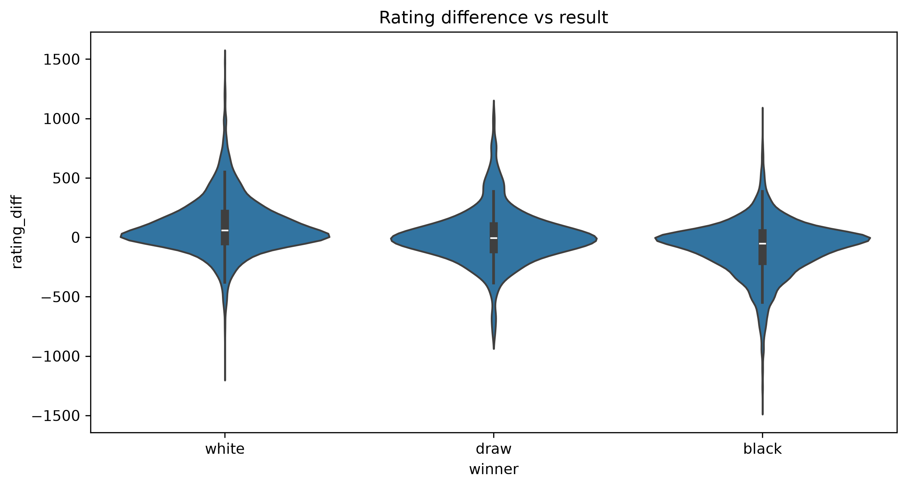

The three distributions partially overlap, with a mirror-image pattern between `white` and `black` (long tails on both sides): this suggests that the rating difference is a good indicator but **not a deterministic one**. Computing the actual win rate of the favorite (excluding draws and cases with `rating_diff = 0`), **65.59%** of decisive games are won by the favorite. This is significantly above 50%, but far from the ~100% one would expect if rating were an almost perfect predictor: **matchmaking based on rating alone leaves a significant margin of "surprise"**.

#### Opening played (opening_eco)

`opening_eco` is a categorical feature with very high cardinality: **339 unique values**. For a readable graphical analysis I considered the **15 most frequent openings**, which alone cover **43.25%** of the observations.

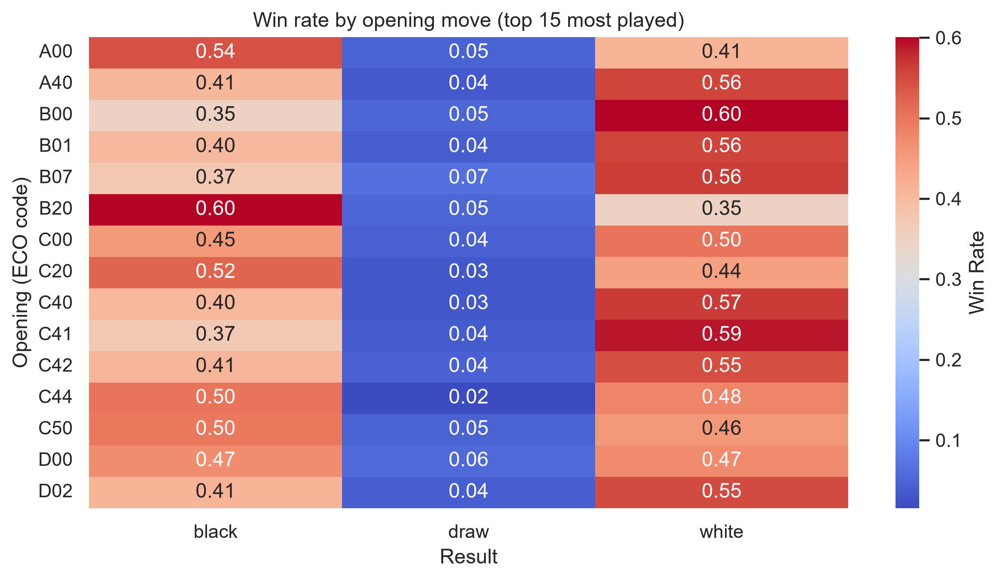

The heatmap shows that some openings are associated more often with Black wins (e.g. `B20`, `A00`) and others with White wins (e.g. `B00`, `C41`). Given the very low number of draws per individual opening, no reliable conclusions can be drawn on the `draw` class, a limitation to keep in mind in the SHAP interpretation later on (Section 5).

#### Rated vs casual games

`rated` indicates whether the game counts for the ranking or is played purely for fun.

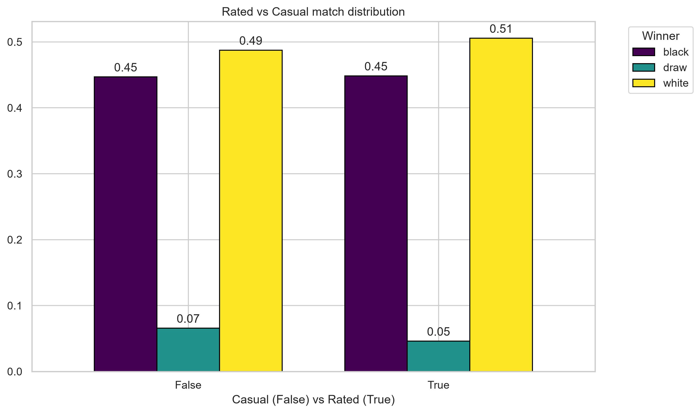

The distribution of outcomes (`white`/`black`) is almost identical between rated and casual games; the share of draws is instead slightly higher in casual games (**6.57%** vs **4.60%** in rated games). A plausible hypothesis: without the ranking at stake, players may settle for a draw more easily. Given the small number of draws in the dataset, this difference should be taken with caution, as it may partly be statistical noise.

I also checked whether the favorite's win rate changes between rated and casual games:

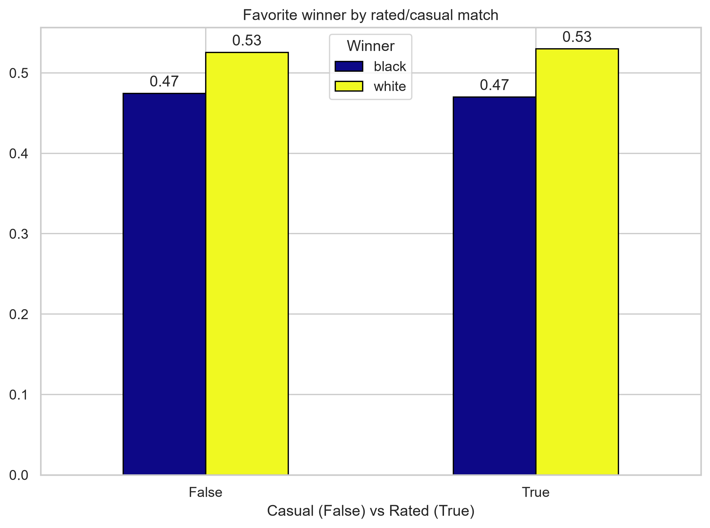

The favorite's win rate is similar in the two cases (**65.17%** rated vs **67.46%** casual): whether a game is rated or casual does not appear to meaningfully affect the predictability of the outcome.

#### Time control vs draws

Using `base_time` and `increment_time_seconds`, I categorized each game into a time control (Bullet/Blitz/Rapid/Classical, following the standard Lichess classification based on estimated minutes) and computed the draw rate for each category:

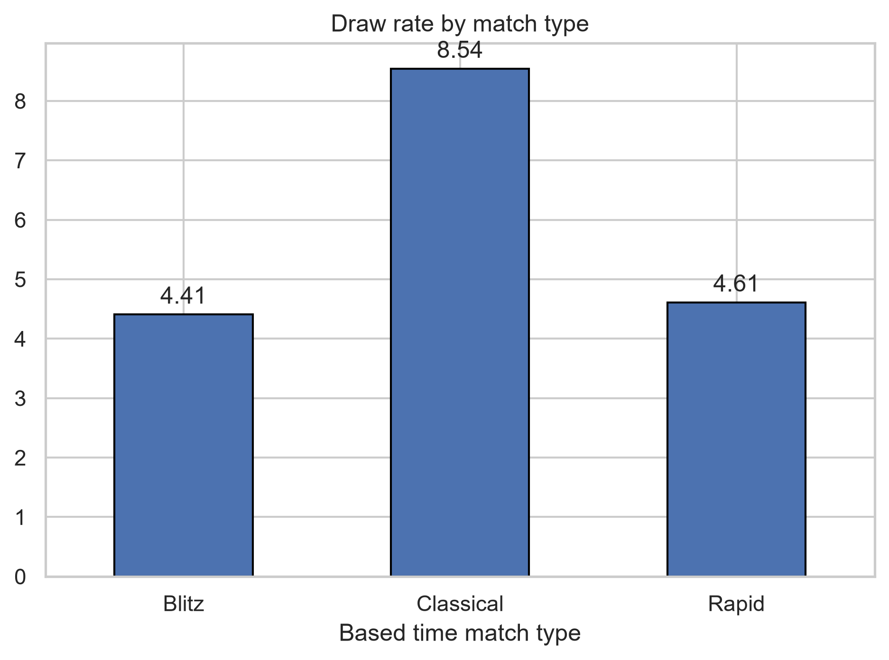

| Time control | Draw rate |
|---|---|
| Blitz | 4.41% |
| Rapid | 4.61% |
| Classical | **8.54%** |

**Classical** games have a draw rate almost double that of Blitz and Rapid. This is consistent with chess intuition: with more time available players make fewer decisive mistakes, making a "balanced" game that ends in a draw more likely. It is a useful signal both for the product (the displayed draw probability should depend on the time control) and for matchmaking. Note that in the cleaned dataset the vast majority of games are Rapid (8,546), with Blitz and Classical much rarer (1,180 and 1,077 respectively).

#### Rating reliability and player experience

An interesting point is how ratings relate to the total number of games played by each player. I therefore computed, for each `player_id` (combining appearances as White and as Black), the total number of games present in the dataset. It emerged that:

* **74.5%** of players appear **only once** in the dataset.
* Only **6.7%** of players have 5 or more recorded games.

I then tested the hypothesis that players "rarely seen" in the dataset (≤1 game) have a less predictive rating, by comparing the favorite's win rate in the two groups:

* Favorite wins (players with more history): **66.29%**
* Favorite wins (players with ≤1 game in the dataset): **65.13%**

The difference is minimal, so it does not support the hypothesis: **the number of games in this dataset is not an indicator of rating reliability**. This is reasonable: a player who has few games in this snapshot may still have a lot of prior experience elsewhere.

---

## 3. Three-Class Problem (Pre-match Outcome Prediction)

### 3.1 Feature Engineering and Preprocessing Pipeline

The columns actually used by the model are: `rated`, `base_time`, `increment_time_seconds`, `match_category`, `white_rating`, `black_rating`, `rating_diff`, `opening_eco`, `opening_moves` (the latter is the old `opening_ply`, renamed for clarity: the number of "theory" moves played in the opening).

* **Numerical features** (`base_time`, `increment_time_seconds`, `white_rating`, `black_rating`, `rating_diff`, `opening_moves`): standardized with `StandardScaler`.
* **Categorical features** (`rated`, `match_category`, `opening_eco`): encoded with `OneHotEncoder`.
  * For `opening_eco` (339 unique categories) a "full" one-hot encoding would have produced hundreds of sparse columns. I used `OneHotEncoder(max_categories=21, handle_unknown='infrequent_if_exist')`: it keeps the 20 most frequent openings and groups all the others into an `infrequent` category. As an alternative I considered a manual grouping (top 20 computed on the training set plus an `'Other'` column via `.apply()`), which is more explicit but would require saving and re-applying the list of openings separately at inference time: `OneHotEncoder` builds this guarantee directly into the pipeline, simplifying serialization.

### 3.2 Classification Models and Comparison

Evaluation metrics, explicitly motivated before the comparison:

* **Log-Loss** -> quality of the probability (it is what the product will actually show to the user in the lobby, hence the primary metric for model selection).
* **F1 (Macro)** -> quality of the classification, weighting the three classes equally.
* **Confusion Matrix** -> visual diagnosis of the errors per class.

The following were trained and compared: Dummy (baseline, `prior` strategy), Logistic Regression (also in a `class_weight='balanced'` version), Random Forest (baseline and tuned via `GridSearchCV`, `scoring='neg_log_loss'`), XGBoost (baseline and tuned, same scoring).

| Model | Accuracy | F1 black | F1 draw | F1 white | F1 Macro | F1 Weighted | Log-Loss |
|---|---|---|---|---|---|---|---|
| Dummy | 0.502 | 0.000 | 0.000 | 0.669 | 0.223 | 0.336 | 0.855 |
| Logistic Regression | 0.617 | 0.590 | 0.000 | 0.668 | 0.419 | 0.600 | 0.787 |
| Logistic Regression (balanced) | 0.504 | 0.562 | 0.097 | 0.582 | 0.414 | 0.549 | 1.015 |
| Random Forest | 0.607 | 0.592 | 0.109 | 0.648 | 0.449 | 0.596 | 0.816 |
| **Random Forest Tuned** | 0.625 | 0.599 | 0.018 | 0.674 | 0.430 | **0.608** | **0.773** |
| XGBoost | 0.600 | 0.580 | 0.084 | 0.645 | 0.436 | 0.588 | 0.839 |
| XGBoost Tuned | 0.613 | 0.580 | 0.018 | 0.667 | 0.422 | 0.596 | 0.784 |

**Observations:**

* All models based on `rating_diff` clearly beat the Dummy in both Log-Loss and F1, confirming that the rating difference carries real information; however, consistently with the 65.59% seen in the EDA, no model comes close to an accuracy near 100%.
* **Random Forest Tuned** obtains the best Log-Loss (0.773) and is chosen as the final model for the product use case, since the explicit priority of the brief is to show a **reliable probability**, not to maximize classification accuracy.
* An interesting point to flag: the untuned Random Forest actually has the highest macro F1 (0.449) and the best F1 on the `draw` class (0.109) among all the tree-based models. The tuning, performed by optimizing `neg_log_loss` (consistently with the chosen primary metric), improves the Log-Loss but worsens the model's ability to correctly identify draws (F1 draw drops from 0.109 to 0.018: precision 1.00 but recall 0.01, i.e. the tuned model practically identifies almost no draws correctly). This is a real trade-off dictated by the chosen metric.
* I tested `class_weight='balanced'` on the Logistic Regression to address the imbalance: it marginally improves recall on the `draw` class (F1 draw goes from 0.00 to 0.097) but significantly worsens the Log-Loss (from 0.787 to 1.015) and the overall macro F1. Since the product's priority is the quality of the probability, I chose not to adopt class weighting for the final model.

### 3.3 Calibration Curve

Since the model will show a probability to a real user, I checked the calibration of Random Forest Tuned with one-vs-rest reliability diagrams (`calibration_curve`) and the Brier Score per class.

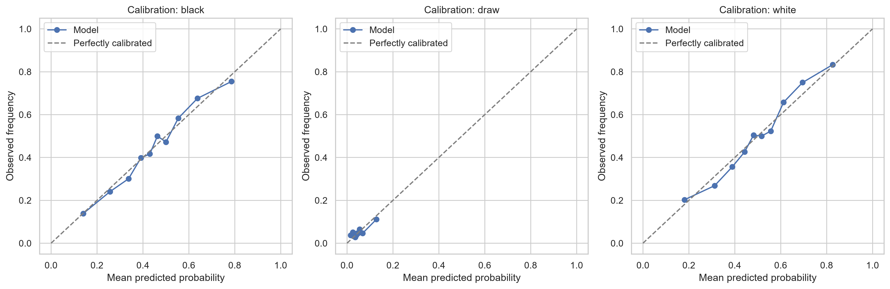

| Class | Brier Score (model) | Brier Score baseline (prediction = average frequency) |
|---|---|---|
| black | 0.2135 | - |
| draw | 0.0467 | 0.0473 |
| white | 0.2135 | - |

**Interpretation:** the calibration curves show that the predicted probabilities for `black` and `white` match the observed frequencies well: good calibration and good discriminative power for these two classes. The `draw` class is also well calibrated, but its Brier Score (0.0467) is **practically identical** to that of a trivial model that always predicted the average frequency of draws in the training set (0.0473). In short, the model has no real predictive signal for draws beyond their base frequency, and it is not useful for telling when a draw is more or less likely.

---

## 4. Binary Classification: "The Favorite Does NOT Win" (Matchmaking Use Case)

### 4.1 Problem Definition

* **Binary target**: `favorite_not_win = True` if the favorite player (higher rating) **does not win** (loses or draws); `False` if they win.
* The **102 games (0.94%)** with `rating_diff = 0` were excluded, where the concept of "favorite" is not well defined.
* On the resulting dataset (10,701 games), the target balance is: `favorite_not_win = False` (favorite wins) **62.35%**, `favorite_not_win = True` **37.65%**. A more moderate imbalance than in the 3-class problem, but still to be taken into account in the choice of metrics.

### 4.2 Pipeline and Binary Models

The preprocessing pipeline is identical to that of the 3-class problem, so it was cloned (`clone(preprocessor)`) and refitted from scratch on the train/test split specific to this problem.

The primary metric chosen here is **F1 Macro**, not Log-Loss. Since the task of this model is not to show a probability to the end user, but to support a binary **decision** by the matchmaking team, what matters is the quality of the classification on the two classes, weighted equally.

| Model | Accuracy | F1 Favorite wins | F1 Favorite does not win | F1 Macro | Log-Loss |
|---|---|---|---|---|---|
| Dummy | 0.624 | 0.768 | 0.000 | 0.384 | 0.662 |
| Logistic Regression | 0.623 | 0.768 | 0.002 | 0.385 | 0.667 |
| Logistic Regression (balanced) | 0.502 | 0.536 | 0.463 | 0.499 | 0.698 |
| Random Forest | 0.614 | 0.716 | 0.396 | 0.556 | 0.638 |
| Random Forest Tuned | 0.623 | 0.729 | 0.383 | 0.556 | 0.628 |
| **XGBoost (baseline)** | 0.618 | 0.714 | 0.425 | **0.570** | 0.670 |
| XGBoost Tuned | 0.608 | 0.698 | 0.439 | 0.568 | 0.868 |

**Model choice: XGBoost baseline (untuned).** It has the highest F1 Macro of all models (0.570), including the "Tuned" version.

### 4.3 Decision Threshold Analysis

The XGBoost model produces a probability for the class "favorite does not win". The default threshold (0.5) corresponds, in the table above, to precision 0.49 and **recall of only 0.37**.

In this context it is useful to consider that:

* A **false positive** is a normal game flagged as suspicious, so the matchmaking team wastes time analyzing it.
* A **false negative** is a real matchmaking anomaly that goes unnoticed, so the issue of interest (an unbalanced pairing) is never detected or corrected.

Given this asymmetry, I chose to **favor recall by lowering the threshold** below the default value:

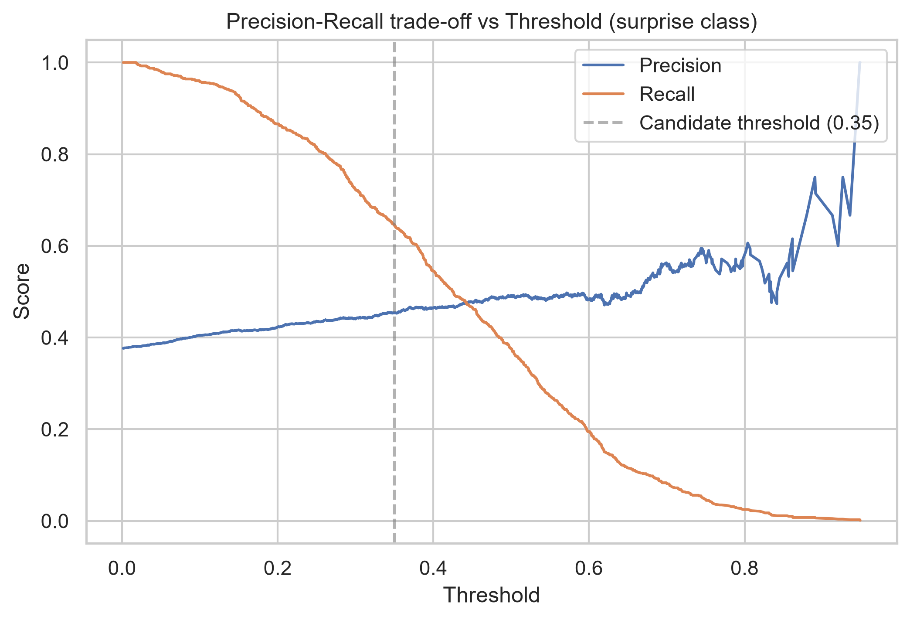

| Threshold | Precision (favorite does not win) | Recall (favorite does not win) | F1 |
|---|---|---|---|
| 0.50 (default) | 0.49 | 0.37 | 0.43 |
| 0.40 | 0.47 | 0.54 | 0.50 |
| **0.35 (chosen)** | 0.45 | **0.65** | **0.53** |
| 0.30 | 0.44 | 0.72 | 0.55 |
| 0.25 | — | — | — |

**Chosen threshold: 0.35.** Compared to the default, it almost doubles the recall (from 37% to 65%) at the cost of a limited loss of precision (from 49% to 45%). I discarded even lower thresholds (0.30, 0.25) because, although recall keeps rising, the marginal gain is paid for with a growing loss of precisio. The chosen threshold represents a reasonable compromise.

---

## 5. Feature Importance & SHAP Analysis

### 5.1 Multiclass Model (Random Forest Tuned)

Below is the feature importance analysis for the model chosen for the multiclass classification.

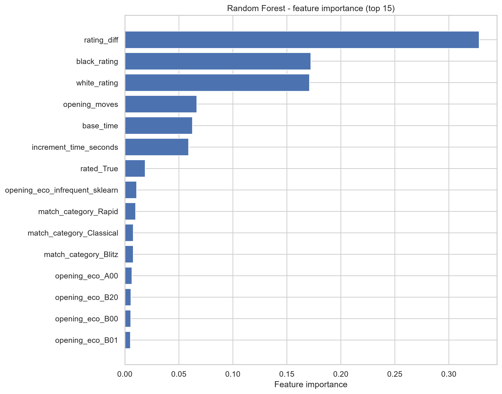

The native (impurity-based) importance confirms `rating_diff`, `white_rating` and `black_rating` as the dominant features. Aggregating all the one-hot columns of `opening_eco` into a single value (so as not to underestimate their overall weight compared with single features), the opening played still accounts for only **9.6%** of the total importance, a secondary contribution compared with the rating difference.

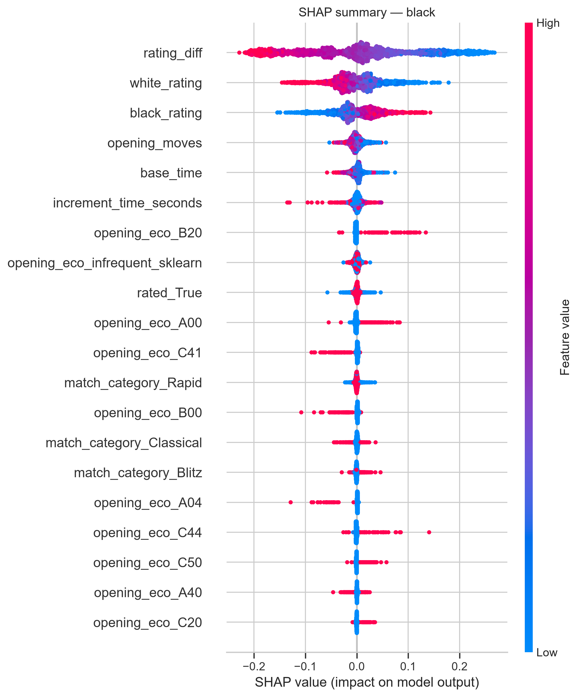
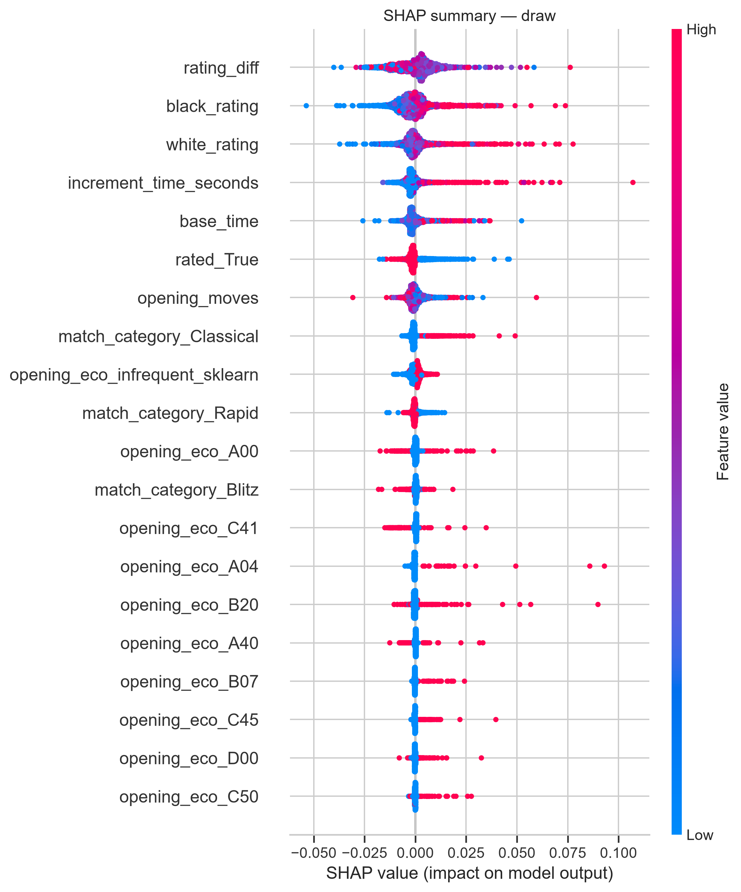
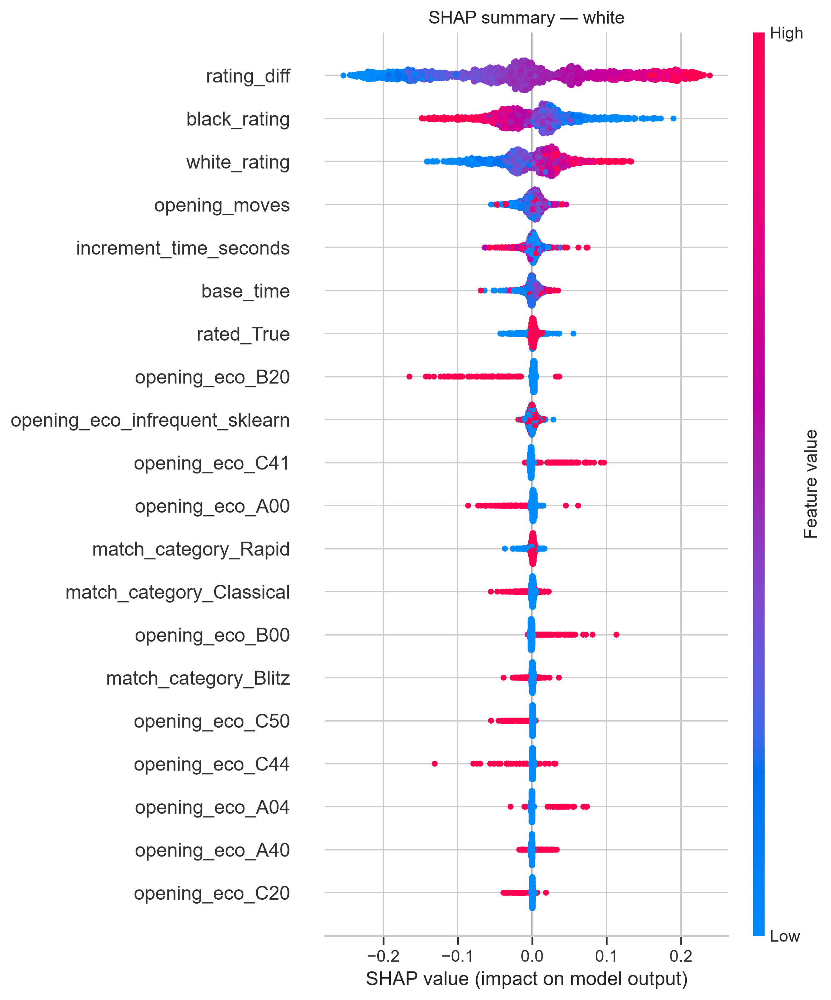

The SHAP analysis (TreeExplainer, values for the three classes) confirms and enriches this picture:

* The effect of `rating_diff` is mirrored between the `black` and `white` classes (a large difference in favor of White pushes White's win probability up and Black's down, and vice versa), consistent with the EDA.
* The `B20` opening tends to favor the prediction of the `black` class.
* For the `draw` class no clear, dominant pattern emerges: the time-control features (`base_time`, `increment_time_seconds`) show an effect without a clear direction, while `rated` shows a more interesting impact distribution, in line with what was observed in the EDA (draws are slightly more frequent in casual games). This lack of a strong signal on the `draw` class is consistent with what was already seen in the calibration (Section 3.3): the model has no real predictive power on draws beyond their base frequency.

### 5.2 Binary Model (XGBoost)

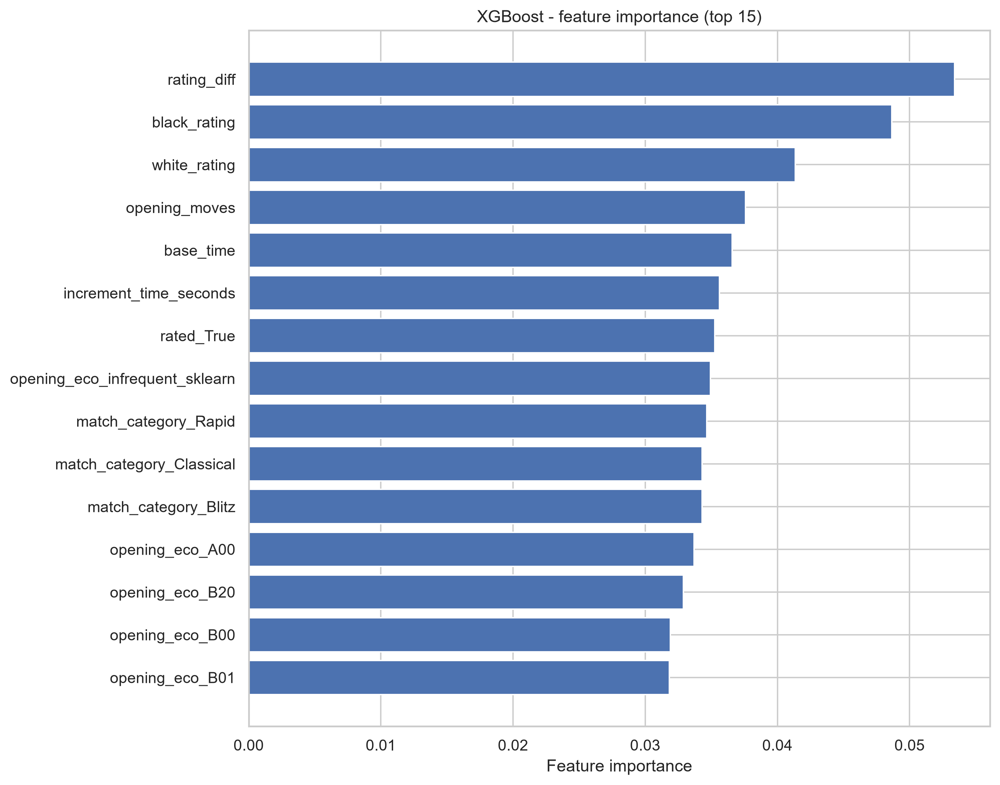
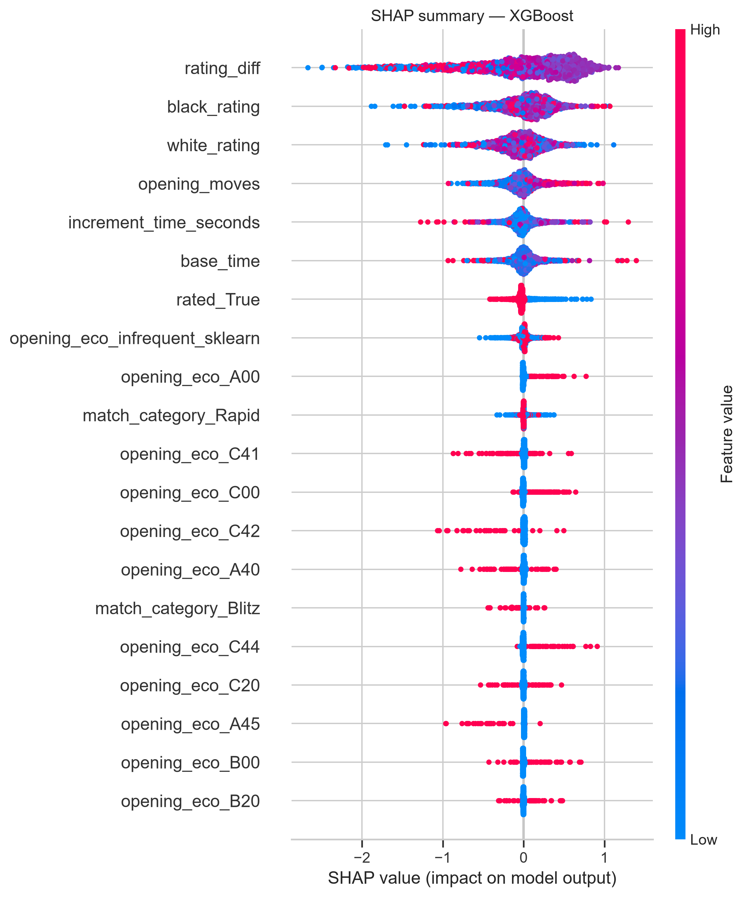

Here too `rating_diff` remains the leading feature, but a flattening of the importance values is more evident, so the gap with the other features is not as sharp. This can probably be explained by the fact that predicting the non-favorite wins is less influenced by this single factor. The idea links back to the EDA, where only about **65%** of favorites win. With these very flat values, the analysis of the SHAP values can help understand and contextualize the role of the features in the prediction. It shows that:

* `rating_diff` remains the leading factor, but with a less sharp behavior than in the 3-class model.
* `opening_moves` (the number of theory moves played) shows a clear impact pattern.
* `rated` confirms what was seen in the EDA: casual games (`rated = False`) are associated with more frequent upset outcomes.
* Some specific openings (`A00`, `C00`, ...) show clear individual patterns in the SHAP values.

---

## 6. Serialization, Inference Module and Tests

### 6.1 Saved Artifacts

* **Saved models** (`models/` folder, via `joblib`):
  * `three_classification_model.pkl` — Random Forest Tuned pipeline (preprocessing + model) for the 3-class problem.
  * `binary_model.pkl` — XGBoost baseline pipeline (preprocessing + model) for the binary problem.
  * `config_params.json` — parameters that cannot be derived from the model alone: the binary decision threshold (`binary_threshold: 0.35`) and the class names for both problems. The names of the three classes (`black`, `draw`, `white`) are stored in the same order as the columns of `predict_proba`, so no separate `LabelEncoder` is needed at inference time: the models and the configuration file are enough to reproduce the predictions.
* **Integrity check**: after saving, the model was reloaded from disk and compared (`np.allclose`) with the probabilities produced by the original in-memory object, confirming that serialization introduces no discrepancy. Loading was also verified in a Python process separate from the notebook, to rule out hidden dependencies on code defined in the notebook.

### 6.2 Inference Module (`inference.py`)

The inference logic lives in a standalone module that can be imported and tested independently of the notebook, which remains the place for prototyping and analysis:

* `build_features(data)` — builds the features from the pre-match columns only (`white_rating`, `black_rating`, `increment_code`, `opening_eco`, `rated`, and `opening_ply` or `opening_moves`): `rating_diff`, parsing of `increment_code` into `base_time` (minutes) and `increment_time_seconds`, the estimated duration and the time-control category. It validates the input with explicit errors (missing columns, invalid `increment_code` format) and **never drops rows**: the output has the same rows and the same index as the input. The training-data cleaning (zero-duration games, 2x tolerance) stays in the notebook, because it requires information that is not available before the game.
* `load_artifacts(models_dir=None)` — loads the models and the configuration once, and derives from the fitted `OneHotEncoder` the set of openings seen during training. It checks that the files exist and that the class names in the config are consistent with the model.
* `predict_match_outcome(match_data, artifacts=None)` — accepts a single match (dictionary) or a batch (list of dictionaries) and returns, for each match and in input order, the probabilities for the three classes, the "upset" probability (binary model), the flag based on the 0.35 threshold, and a data-quality flag (`opening_eco_unknown`). If no artifacts are passed, they are loaded once and reused in later calls.

The check on unknown openings came from a concrete test case: when passing a value with a typo (`'AOO'` with the letter O instead of `'A00'` with a zero), the function correctly emitted a `UserWarning` instead of failing silently or treating it as any other valid category.

Example run on two matches (one valid, one with a wrong `opening_eco`):

| | proba_black | proba_draw | proba_white | surprise_probability | flagged_as_potential_surprise | opening_eco_unknown |
|---|---|---|---|---|---|---|
| Match 1 (B20, valid data) | 0.529 | 0.046 | 0.425 | 0.380 | **True** | False |
| Match 2 (`'AOO'`, typo) | 0.691 | 0.028 | 0.281 | 0.054 | False | **True** |

This same mechanism (`opening_eco_unknown`) is also the simplest and cheapest starting point for a *drift* signal in production (see Section 9): if the share of games with an "unseen" opening grows over time, it is a direct indicator that the distribution of openings is shifting away from the training one.

### 6.3 Automated Tests

The suite in `tests/test_inference.py` (pytest) checks the behavior of the module:

* an unknown `opening_eco` produces a `UserWarning` and the `opening_eco_unknown` flag;
* a missing required column and a malformed `increment_code` each raise a `ValueError`;
* `opening_ply` and `opening_moves` give the same result;
* `build_features` keeps rows and index and does not modify its input;
* the probabilities of the three classes sum to 1;
* **reproduction test**: the predictions match (relative tolerance 1e-6) those produced by the original notebook function, saved in `tests/expected_predictions.csv`, confirming that the refactoring did not change the behavior.

To run them, from the project root: `python -m pytest -v`.

---

## 7. Operational Conclusions for Product and Matchmaking

**For the product team (pre-match probabilities in the lobby):**
* The chosen model (Random Forest Tuned) produces well-calibrated probabilities for decisive outcomes (`black`/`white`), which can be reliably used as an indicator shown to the user.
* The displayed draw probability **must not be presented as a refined case-by-case estimate**: the model has no real predictive signal beyond the overall historical frequency (~5%).
* The time control (Bullet/Blitz/Rapid/Classical) visibly affects the expected draw rate, so if one wanted to improve the draw estimate in the future, it is the most promising direction to explore.

**For the matchmaking team:**
* The current rating predicts the outcome better than chance, but leaves a real margin of surprise: the favorite wins only **65.59%** of decisive games. Matchmaking based on the rating difference alone does not eliminate unexpected outcomes, and should not be presented internally as if it did.
* The binary matchmaking model (XGBoost, threshold 0.35) is designed to **maximize the ability to detect** games at risk of an upset (recall 65%), accepting a larger number of false positives.
* **Casual** (non-rated) games show a slightly higher share of upset outcomes than rated ones: a potentially useful signal if the matchmaking team wanted to differentiate alert thresholds by game type.
* `rating_diff` remains, by a wide margin, the single most important factor in both models.

---

## 8. Excluded Columns and Rationale

| Column | Reason for exclusion |
|---|---|
| `turns` | Total number of moves in the game: known only at the end of the game, hence post-match information (leakage) not available at prediction time. |
| `victory_status` | Describes how the game ended (checkmate, resignation, timeout, draw): it is a direct consequence of the outcome, not a pre-match predictor. |
| `moves` | Complete sequence of the moves played: available only during or after the game. |
| `white_id`, `black_id` | Player identifiers: very high cardinality and very few repeated occurrences in the dataset (74.5% of players appear only once), so they do not generalize as categorical features. |
| `white_total_matches`, `black_total_matches` | Derived features built only to test the hypothesis on rating reliability in the EDA (Section 2.3); the hypothesis was rejected (no relevant difference), so they were not carried into the modelling pipeline. |
| `opening_name` | Textual/descriptive version of the same information already encoded by `opening_eco`: redundant, and with even higher cardinality. |
| `start_time`, `end_time`, `play_time`, `estimated_play_time` | Used exclusively in the EDA and data-cleaning phase (to identify and remove anomalous games); they are not pre-match information to feed to the model. |
| `id` | Unique game identifier, no predictive value. |

---

## 9. Monitoring and Retraining Plan

The data used in this project should be regarded as a static snapshot of Lichess games, tied to a specific period, rating system and player population. What follows proposes how to keep the model reliable over time.

### 9.1 What the Model Learned, and What Could Make It Obsolete

* **Evolution of the rating system.** If the way the rating is computed is revised or updated on Lichess, `rating_diff` (the most important feature in both models) would no longer mean the same thing as at training time.
* **Evolution of openings.** Openings can change over time, especially according to the habits of the players in the dataset. This directly affects the encoding of `opening_eco`, whose "top-20 + infrequent" grouping was learned once on the training set and does not update itself.
* **Change in the user base.** The EDA showed that 74.5% of players appear only once in the dataset, and that the distribution of rated/casual games and of time controls (Bullet/Blitz/Rapid/Classical) is not uniform. A change in this mix alters the distribution of the incoming data even if the definition of a single feature does not change.

### 9.2 What to Monitor in Production, and How Often

| Signal | Metric | Frequency | Why |
|---|---|---|---|
| Probability quality (3-class model) | Log-Loss on a window of resolved games | Weekly | Directly measures the reliability of the probabilities |
| Classification quality (3-class model) | F1 Macro, recall per class | Weekly | Confirms that the model keeps separating the outcomes correctly |
| Matchmaking model quality (binary) | F1 Macro, recall on "favorite does not win" | Weekly | It is the metric on which the model was selected; a drop means fewer real upsets flagged |
| Calibration | Reliability diagram / Brier Score, recomputed periodically | Monthly | Calibration can degrade even when the discriminative metrics look stable |
| Input drift — rating | Distribution of `white_rating`, `black_rating`, `rating_diff` compared with training | Weekly | Sudden changes in rating indicate a changing player population |
| Input drift — openings | % of games with `opening_eco` in the "infrequent" category (the `opening_eco_unknown` flag already built into the inference function) | Weekly | A growing share of "unknown" openings is a direct drift signal, already built into the serialized pipeline |
| Input drift — game format | Distribution of `match_category`, `rated` | Monthly | Changes in the popularity of time controls alter the behavior of the players on whom the model was trained |

### 9.3 Retraining Policy

An approach to the method and timing of model retraining is proposed below:

* **Scheduled retraining: every 2-3 months.** Since features such as the rating and opening trends can change slowly over time, a default cadence of 2-3 months for retraining could be considered.
* **Triggered retraining, regardless of the calendar, if:**
  * the Log-Loss of the 3-class model rises by more than ~10% compared with its own baseline value;
  * the share of "infrequent" openings more than doubles compared with the baseline value at training.

An important point to consider for retraining is that the entire notebook pipeline should be reused (cleaning thresholds, feature engineering, preprocessing), rather than just refitting the final model on new rows. This is because some cleaning thresholds (such as the 2x tolerance on `estimated_play_time`) were chosen on the basis of the specific distribution of the training set and should be re-evaluated against the new data.

### 9.4 Artifact Versioning

Each retraining cycle should produce a new set of timestamped artifacts (without overwriting the previous ones), in order to reconstruct any production incident and quickly roll back to the previous model:

```
models/
├── 2026-10-02/
│   ├── three_classification_model.pkl
│   ├── binary_model.pkl
│   └── config_params.json   # includes binary_threshold, class names
│                             # AND the metrics on which this version was validated
├── 2027-01-05/
│   └── ...
```

Including the model's validation metrics directly in `config_params.json` (not just the threshold) makes each artifact self-describing: anyone loading a given version can immediately see the performance on which it was validated, without having to dig up old notebooks.

### 9.5 Two Requirements from the Brief Not to Miss

Since the brief explicitly asks how to detect drift signals and how to validate a new model, after researching useful indicators for this case I concluded that:

* **Drift detection (beyond simply monitoring mean values):** for numerical features (`rating_diff`, the ratings, `base_time`...) an index such as the **PSI (Population Stability Index)** or a **Kolmogorov-Smirnov** test between the recent production window and the training distribution can be used to highlight drift in these features; for categorical ones (`opening_eco`, `match_category`) a **chi-square test** can be considered or, more simply, monitoring the "infrequent" share already planned above.
* **Pre-replacement validation:** compare the candidate model and the one in production on the same recent window of data, using the same metrics as in Sections 3/4 (Log-Loss, F1 Macro, calibration); one can promote the candidate only if it does not regress on the primary metrics and recognizes the patterns of the most important features (e.g. sign and weight of `rating_diff`, role of `B20`).

---

## 10. Future Work

* **Advanced handling of the `draw` class**: approaches such as SMOTE (synthetic oversampling) or other types of models could be tested, bearing in mind the evidence from this project that the predictive signal available for draws is intrinsically weak (few examples available).
* **Historical player features**: other features, such as recent win/loss streaks, could be very interesting for model performance.
* **Explicit calibration** (`CalibratedClassifierCV`): apply it to the 3-class model and compare Log-Loss and Brier Score on held-out data, paying attention to the range of small `rating_diff` where the model is more uncertain. The expected gain is marginal, since `black` and `white` are already well calibrated and there is no signal to correct for `draw`; it should still be verified and documented.
